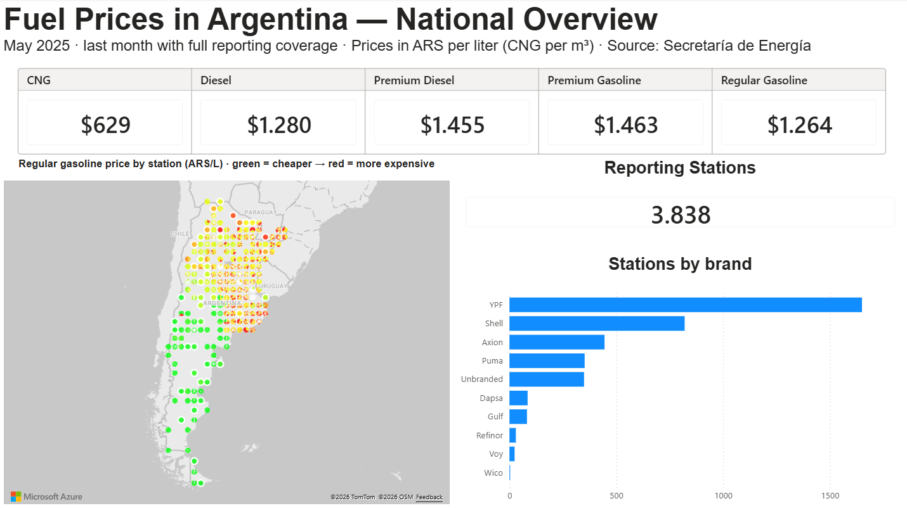
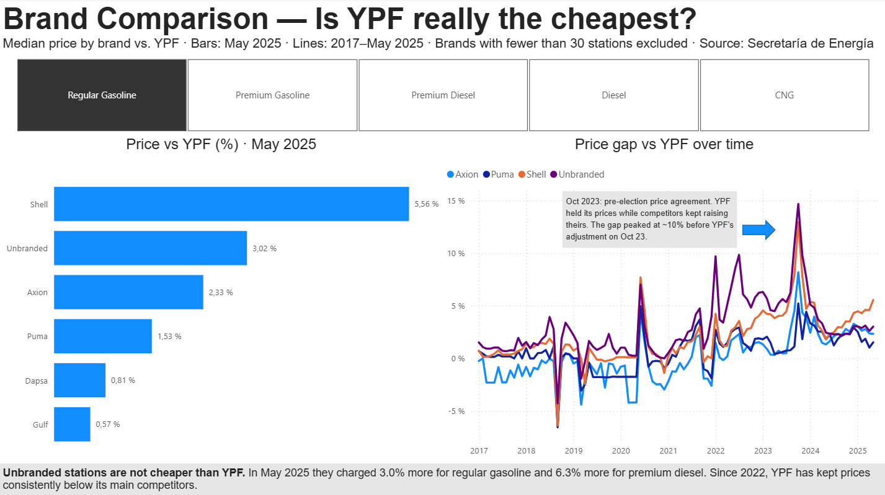
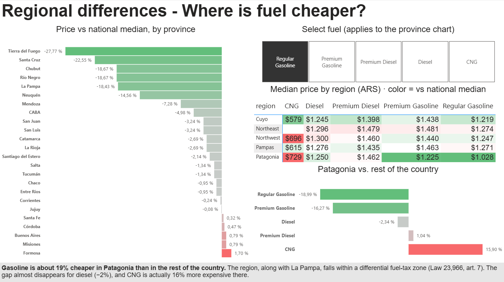
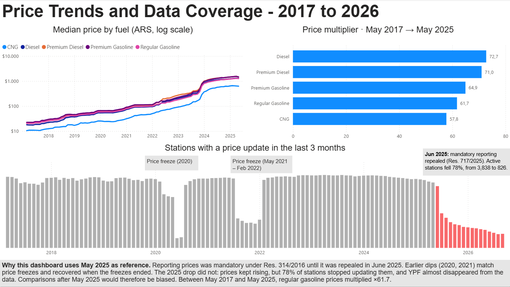

# Fuel Prices in Argentina (2017–2026): Data Cleaning & Power BI Dashboard

End-to-end analysis of **3.4 million fuel price records** reported by gas stations across Argentina: from a messy public dataset to a cleaned data model and a 4-page interactive Power BI dashboard.



## Key findings

- **Unbranded stations are not cheaper than YPF.** In May 2025 they charged 3.0% more for regular gasoline and 6.3% more for premium diesel.
- **YPF has been the cheapest major brand since 2022.** Before 2022, Shell was within 0–1% of YPF; since then it has been 4.5–5.6% more expensive.
- **The gap peaked in October 2023 (+10%)**, during a pre-election price agreement: YPF held its prices while competitors kept raising theirs.
- **Gasoline is ~19% cheaper in Patagonia** (and La Pampa), a region with a differential fuel-tax regime. The discount almost disappears for diesel (−2%), and CNG is actually 16% *more* expensive there.
- **Regular gasoline prices multiplied ×61.7** between May 2017 and May 2025.
- **Data coverage collapsed after June 2025**, when mandatory price reporting was repealed: active stations fell 78% and YPF almost disappeared from the data. All comparisons therefore use **May 2025**, the last month with full coverage.

## Dashboard

| Brands | Regions | Trends & coverage |
|---|---|---|
|  |  |  |

1. **Overview**: current prices per fuel, a map of 3,800+ stations colored by price, and stations by brand.
2. **Brands**: price vs. YPF per brand, and how the gap evolved since 2017.
3. **Regions**: price vs. national median for every province, a regional heat table, and Patagonia vs. the rest of the country.
4. **Trends**: price evolution per fuel (log scale), price multipliers, and reporting coverage over time.

## Data

- **Source:** Secretaría de Energía (Argentina), [*Precios en Surtidor – Resolución 314/2016*](http://datos.energia.gob.ar/dataset/precios-en-surtidor), public open data.
- **Historical file:** one row per price change, 3,379,896 rows (742 MB), 2017–2026, 5,704 stations, 24 provinces, 5 fuels.
- **Current file:** latest reported price per station and fuel.

The raw files are not included in this repository because of their size. Download them from the link above into a `datos/` folder.

## Data cleaning (Python)

The raw data required substantial cleaning. `limpieza.py` processes the 742 MB file in chunks and produces three tidy tables plus a data quality report.

| Step | Rows |
|---|---:|
| Raw rows | 3,379,896 |
| Night-shift duplicates removed (day and night prices match in >99% of cases) | 1,689,915 |
| Dates out of range (e.g. year 1 or 9920) | 193 |
| Zero or negative prices | 100 |
| Duplicate reports (same station, fuel and timestamp) | 1,039 |
| Outliers (<50% or >200% of the national median for that fuel and month) | 6,602 |
| **Valid price changes** | **1,682,047** |

Other transformations:

- **Monthly panel:** the source only records price *changes*, so the last price of each month is carried forward for up to 2 months when a station reports no change (1.54M rows).
- **Normalization:** brand names (e.g. `SHELL C.A.P.S.A.` → `Shell`, `BLANCA` → `Unbranded`), province names, and English product names.
- **Regions rebuilt from provinces:** the source's region column mixed geography with the Patagonian tax zone and contained errors.
- **Coordinates validated:** points outside Argentina were blanked so they do not break the map.

The full report is in [`salida/data_quality_report.md`](salida/data_quality_report.md).

## Methodology notes

- **Median, not mean:** medians are robust to the few extreme prices that remain after cleaning.
- **Reference month (May 2025):** after mandatory reporting was repealed (Res. 717/2025, June 2025), the number of reporting stations dropped sharply and unevenly by brand, which would bias any later comparison.
- **What "active stations" measures:** stations with a price update in the last 3 months. Earlier dips in 2020 and 2021 match government price freezes (nothing to update) and recovered when the freezes ended. The 2025 drop did not recover, even though prices kept rising.
- **Brand comparisons** exclude brands with fewer than 30 stations.

## Power BI model

- **Tables:** `stations` (dimension), `monthly_prices` and `current_prices` (facts), related by `station_id`.
- **Key DAX measures:** median price, reporting stations, price vs. YPF, price vs. national median, Patagonia vs. rest of the country, and price multiplier.
- **Visuals:** Azure Maps, conditional formatting, a log-scale axis, and slicers.

## Repository structure

```
├── limpieza.py                  # data cleaning script
├── requirements.txt
├── salida/
│   └── data_quality_report.md   # generated by limpieza.py
├── capturas/                    # dashboard screenshots
└── README.md
```

## How to reproduce

1. Download both CSV files from the source into `datos/` as `precios-historicos.csv` and `precios-vigentes.csv`.
2. Install the dependencies: `pip install -r requirements.txt`
3. Run the cleaning script: `python limpieza.py`. It writes the clean tables to `salida/`.
4. Open the Power BI file and refresh the data. If your system uses a comma as the decimal separator, set the file's import locale to *English (United States)*.

## Tools

Python (pandas) · Power BI (DAX, Power Query, Azure Maps)

---

**Francisco Franco**, Data Analyst · [Upwork profile](https://www.upwork.com/freelancers/~012876f32e7ba87f35)
